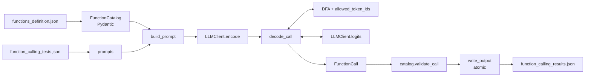

*This project has been created as part of the 42 curriculum by dilferre.*

# Call Me Maybe

[](https://github.com/DiOliver-cmd/Call-Me-Maybe_2026_42SP/actions/workflows/ci.yml)


**Function calling with constrained decoding.** A local `Qwen/Qwen3-0.6B` model
proposes the next token; a hand-written DFA and a logit mask reject every token
that would break the output grammar; the pipeline writes one validated function
call per prompt. There is no keyword routing, no fine-tuning and no guided-
generation library: the model makes the semantic decision, the decoder enforces
the structure.

```json
// input request
{"prompt": "What is the sum of 2 and 3?"}

// output call (one object per prompt, in input order)
{"prompt": "What is the sum of 2 and 3?", "name": "fn_add_numbers",
 "parameters": {"a": 2, "b": 3}}
```

---

## Table of contents

- [Description](#description)
- [Instructions](#instructions)
- [Example usage](#example-usage)
- [Architecture](#architecture)
- [Algorithm explanation](#algorithm-explanation)
- [Design decisions](#design-decisions)
- [Performance analysis](#performance-analysis)
- [Testing strategy](#testing-strategy)
- [Challenges faced](#challenges-faced)
- [Limitations and known issues](#limitations-and-known-issues)
- [Subject compliance](#subject-compliance)
- [Resources and theoretical background](#resources-and-theoretical-background)
- [How AI was used](#how-ai-was-used)
- [Project structure](#project-structure)
- [Roadmap](#roadmap)

---

## Description

The project turns a natural-language request into a call to one of the functions
declared in `data/input/functions_definition.json`, using the model provided by
the local `llm_sdk`. The default catalog has six functions (add numbers, greet,
reverse a string, square root, regex substitution, alarm on/off) and the fixture
has 17 requests, but the implementation is data-driven: the catalog can be
replaced at runtime with the `--functions_definition` flag.

The hard part is not asking a model to "return JSON"; it is making a 0.6B model
return **valid** JSON every time while keeping the decision with the model.
Sampling or prompt-only approaches fail: the unconstrained baseline produced
only **1/10 valid JSON, 1/10 correct function and 1/10 correct arguments** on
the first ten fixture prompts. This project solves the structural half with
constrained decoding and measures the semantic half honestly:

| Property | Result |
| --- | --- |
| Structurally valid and schema-valid calls | **17/17 (100%)**, by construction |
| Correct function (16 defined prompts) | **16/16 (100%)** |
| Correct arguments (16 defined prompts) | **10/16 (62.5%)** — see [accuracy](#accuracy-and-known-gap) |
| Full 17-prompt run | **180.24 s** on the development CPU (< 300 s target) |

The structural guarantee comes from a DFA with 30 states plus a mask over the
151,936 model logits. The semantic gap is concentrated in long string values and
is documented rather than hidden behind heuristics. See
[`experiments/accuracy.md`](experiments/accuracy.md) for the full table and
[`experiments/report.md`](experiments/report.md) for the packaged metrics.

---

## Instructions

### Requirements

- Python **3.10+** (the development machine uses 3.13).
- [`uv`](https://docs.astral.sh/uv/) for installation and execution.
- ~2 GB of disk for the CPU model and the Hugging Face cache.
- No GPU is required. The default model runs on CPU.

### Install

```bash
git clone https://github.com/DiOliver-cmd/Call-Me-Maybe_2026_42SP.git
cd Call-Me-Maybe_2026_42SP

make uv        # installs uv in ~/.local/bin if it is missing (no sudo)
make install   # uv sync
```

`uv sync` is the only installation step, as required by the subject. The
provided `llm_sdk/` is used as an editable local dependency and is never
modified.

### Run

```bash
make run
# equivalent to:
uv run python -m src
```

The default paths are:

| Flag | Default |
| --- | --- |
| `--functions_definition` | `data/input/functions_definition.json` |
| `--input` | `data/input/function_calling_tests.json` |
| `--output` | `data/output/function_calling_results.json` |

A successful run is silent and writes the output file. Expected failures print
one `error: ...` line to stderr and exit with status 1, without a traceback.
The output directory is generated at run time and is intentionally gitignored.

The first run on a new machine downloads the model (~40 s on the development
machine) and builds the token-text cache under `.cache/token_text.json`; later
runs reuse both. The measured default run is **180.24 s** for all 17 prompts.

### Make targets

| Target | What it does |
| --- | --- |
| `make uv` | installs `uv` locally when missing |
| `make install` | `uv sync` |
| `make run` | `uv run python -m src` |
| `make debug` | opens `pdb` at the CLI entry point |
| `make test` | `pytest -q -m "not slow"` (no model download) |
| `make test-all` | full suite, including slow model-backed tests |
| `make lint` | `flake8` + `mypy` |
| `make lint-strict` | stricter mypy pass |
| `make clean` | removes caches, `data/output` and bytecode; keeps `.venv` and `.cache` |

### Troubleshooting

- **Model download blocked:** set `HF_HOME`/`HF_HUB_CACHE` to a writable cache,
  or pre-populate the Hugging Face cache. The code never downloads at import
  time; the lazy load happens on the first `encode`.
- **Slow first run:** the model load and the token-text cache build are one-off
  costs; subsequent runs use the cached artifacts.
- **Missing output:** check that the parent directory is writable; `write_output`
  creates it, but an OS error is reported as `error: ...` with the path.
- **`make test` is fast; `make test-all` is not:** the three slow tests load the
  real model and are marked `slow`.

---

## Example usage

Input (`data/input/function_calling_tests.json`):

```json
[
  {"prompt": "What is the sum of 2 and 3?"},
  {"prompt": "Reverse the string 'hello'"},
  {"prompt": "Turn the alarm on."}
]
```

Command:

```bash
uv run python -m src \
  --functions_definition data/input/functions_definition.json \
  --input data/input/function_calling_tests.json \
  --output data/output/function_calling_results.json
```

Output (`data/output/function_calling_results.json`):

```json
[
  {
    "prompt": "What is the sum of 2 and 3?",
    "name": "fn_add_numbers",
    "parameters": {"a": 2, "b": 3}
  },
  {
    "prompt": "Reverse the string 'hello'",
    "name": "fn_reverse_string",
    "parameters": {"s": "hello"}
  },
  {
    "prompt": "Turn the alarm on.",
    "name": "fn_set_alarm",
    "parameters": {"enabled": true}
  }
]
```

Error path:

```console
$ uv run python -m src --input does-not-exist.json
error: failed to read input file 'does-not-exist.json': ...
$ echo $?
1
```

Adding a function does not require code changes: append it to
`functions_definition.json` with a `name`, `description`, `parameters` (each with
a JSON type) and an optional `returns`. The prompt, DFA and schema validation
are all built from the catalog.

---

## Architecture



| Module | Responsibility |
| --- | --- |
| `src/schemas.py` | Pydantic models for the catalog, parameters and output; strict types, `extra="forbid"` |
| `src/data_loader.py` | Load and validate the JSON inputs; typed project errors |
| `src/vocab.py` | Parse `tokenizer.json`, build `token_text`, exclude added/padding ids, first-character index and the per-index mask cache |
| `src/prompt.py` | Deterministic compact prompt, output template and fixed/slot segments |
| `src/dfa.py` | 30-state DFA for the exact output template, with atomic token consumption |
| `src/decoder.py` | Allowed-token mask, logit masking, argmax, EOS/stop policy and the generation loop |
| `src/pipeline.py` | Ordered batch, decoder-index cache, schema validation and atomic output |
| `src/llm_client.py` | Thin typed wrapper over the public `llm_sdk`; lazy load and `ModelError` translation |
| `src/config.py` | `MAX_TOKENS`, deadlines and measured timing constants |
| `src/errors.py` | `ProjectError` hierarchy (`SchemaError`, `ModelError`, `DecodingError`, `BudgetExceededError`) |
| `src/__main__.py` | `argparse` CLI, exit codes and the `error: ...` policy |
| `experiments/` | Baseline, prompt-size, profiling, time-budget and accuracy measurements |
| `tests/` | Deterministic unit/integration suites plus marked slow model tests |

---

## Algorithm explanation

The decoder never asks the model to produce the whole JSON object. It asks for
the **next token**, masks everything that cannot legally follow, and injects the
fixed template text itself.

### 1. Vocabulary and token index

`tokenizer.json` has 151,669 entries; the model exposes 151,936 logit positions.
The index keeps the byte-level fragments, removes the 26 added control tokens
(including `<|im_end|>`, `<|endoftext|>`, `<|tool_call|>` and `<|think|>`) and
builds `token_text` through the SDK's public `decode`. Tokens are bucketed by
first character, so a step narrows the 151k candidates before the full
`startswith`/DFA check (60 candidates for `{`, 424 for `"`).

### 2. Fixed template and slots

The output template is exactly:

```json
{"prompt": <request>, "name": "<function>", "parameters": {<values>}}
```

The keys, quotes, commas and braces are **fixed segments**: they are tokenized
once and injected with `DFA.consume_token`. Only the function name and the
parameter values are model-filled slots. This is why the model cannot invent a
key or reorder the object, and why a live modification of the catalog does not
need a new template.

### 3. DFA

`src/dfa.py` models the template with 30 states (`START` to `ACCEPT`). The state
tracks the current JSON context, the accumulated name prefix, the number buffer,
the literal (`true`/`false`) buffer and Unicode escape digits. A token is
accepted only if **every** character it contains keeps the DFA valid; the
operation is atomic (`try_consume_token` works on a copy, `consume_token`
commits only on success).

### 4. Mask and argmax

For the current state, `allowed_token_ids` returns the ids whose text can be
consumed without leaving the language of the template. Outside a model-filled
slot it returns `()`, so fixed text is never generated by the model. The decoder
then:

1. reads the model logits for the current input ids;
2. sets every non-allowed or non-finite logit to `-inf`;
3. selects the lowest-id argmax among the remaining ids;
4. consumes the selected token and appends it to the output.

If the mask has no finite score, it raises `DecodingError` instead of choosing an
arbitrary token.

### 5. Stop policy

A slot can stop when it already holds a complete name, number, boolean or string
content. The decoder resolves the EOS id by id (never by decoded text, because
`decode` is lossy for byte-level fragments) and lets EOS win only when the DFA
allows it. The number slot has a calibrated bonus: once a number is complete,
`NUMBER_EOS_BONUS = 25.0` is added to the EOS logit so the model stops instead of
continuing with `.0000...` (raw EOS was -2.09 versus a dot at 19.54; see
[`experiments/benchmark.md`](experiments/benchmark.md)). The bonus is a stop
policy, not a function-selection heuristic.

### 6. Validation and output

After `ACCEPT`, the call is parsed and validated twice:

- the DFA guarantees the JSON **shape**;
- `FunctionCatalog.validate_call` guarantees the **semantics**: the name is
  declared, the parameter keys match exactly, and the values have the declared
  types (`bool` never satisfies `number` or `integer`).

The pipeline builds every call before writing anything. `write_output` validates
the whole batch, writes a temporary file in the same directory, flushes/fsyncs
and publishes it with `os.replace`; a failure leaves no partial output.

### Pseudocode

```text
def decode_call(model, catalog, request):
    prompt_ids = model.encode(build_prompt(catalog, request))
    input_ids = prompt_ids
    dfa = DFA.start([f.name for f in catalog])
    for step in range(MAX_TOKENS):
        if dfa.is_accepting() or dfa.can_stop_slot():
            allowed = allowed_token_ids(dfa, index) + [EOS]
        else:
            allowed = allowed_token_ids(dfa, index)
        logits = model.logits(input_ids)
        token = argmax(masked(logits, allowed))
        if token == EOS:
            break
        dfa.consume_token(token_text[token])
        input_ids.append(token)
    call = parse(dfa.output)
    return catalog.validate_call(call)
```

---

## Design decisions

| Decision | Why |
| --- | --- |
| **Template-specific DFA instead of a general JSON parser** | The output shape is fixed, so 30 states are enough. A general parser would add ambiguity and cost; the template also lets fixed text be injected without model calls. |
| **Fixed text injected, only slots generated** | Removes key/order/quote errors by construction and reduces the number of model steps. The decoder never spends a forward pass on `{"prompt":`. |
| **Greedy argmax, no sampling** | Deterministic, reproducible and fast. Sampling after the mask would add variance without improving structural validity. |
| **No keyword routing** | The subject requires the LLM to choose the function. The prompt only presents signatures; the decision is the model's argmax over the masked logits. |
| **Pydantic everywhere** | All input/output classes are validated; strict types catch `true` used as a number and extra keys; the final batch is validated before writing. |
| **Compact prompt** | Every step re-reads the context and the public SDK exposes no KV cache. The compact prompt is 133–151 tokens versus 383–402 for the verbose one, cutting the full run from ~11m42s to 180.24 s. |
| **Number EOS bonus** | The 0.6B model rambles in the number slot; a calibrated EOS bias stops it without changing the grammar or the function choice. |
| **Mask cache keyed by state + buffer** | The expensive string mask is computed once per index. Measurement showed number/boolean/Unicode masks are **not** buffer-independent, so the key includes the relevant buffer; a stale mask would let the DFA reject the selected token. |
| **Atomic output** | A crash or validation failure must not leave a truncated `data/output/` file; `os.replace` publishes only complete batches. |
| **Public SDK only** | The subject forbids private attributes; `src/llm_client.py` is the single boundary and translates SDK failures into `ModelError`. |
| **Data-driven catalog** | Functions and parameters come from JSON; adding a function or a parameter at evaluation time needs no code change. |

---

## Performance analysis

All numbers below were measured on the development machine (CPU, 20 cores,
Python 3.13, `Qwen/Qwen3-0.6B`, cached weights) with the public SDK and greedy
decoding. The full run is the subject's exact command:
`uv run python -m src`.

### Baseline versus constrained

| Pipeline | Valid JSON | Correct function | Correct arguments | Time (10 prompts) |
| --- | ---: | ---: | ---: | ---: |
| Unconstrained argmax, 48-token cap (T3.3) | 1/10 (10%) | 1/10 (10%) | 1/10 (10%) | 1301.6 s |
| Constrained decoding (17 prompts, 16 defined) | 17/17 (100%) | 16/16 (100%) | 10/16 (62.5%) | 180.24 s |

### Runtime

| Measurement | Value |
| --- | ---: |
| Prompt size, compact | 133–151 tokens |
| Model steps, 17 prompts | 235 (13.82 per prompt) |
| Mean forward pass | 0.729 s/step |
| Decoding total | 183.5 s |
| Model load + index build | 8.75 s |
| Wall clock, `python -m src` | **180.24 s** (3m00s) |
| Peak RSS | 4.9 GB |
| Fresh-machine download | ~40 s, total ~232 s, still < 300 s |

The T8.3 profile measured the mask before the compact prompt: mask 8.128 s
(13.2%) versus logits 53.581 s (86.7%) over two prompts. After the per-index
cache, the mask fell to 3.929 s (7.0%, **-51.7%**) and logits dominate at 92.8%.
The remaining cost is the CPU forward pass; the public SDK has no KV cache, so
prompt length is the only large lever.

### Accuracy and known gap

`experiments/accuracy.py` scores the real output against a hand-written ground
truth. Sixteen prompts have a defined answer; prompt 16
(`Do the useful thing with 42 and 'banana'.`) is ambiguous and excluded.

- **Function selection: 16/16 (100%)** — meets the ≥90% target.
- **Argument extraction: 10/16 (62.5%)** — below the ≥90% target.
- **Structural validity: 17/17 (100%)** — the DFA guarantee.

The six failures are all string slots:

| Prompt | Failure |
| --- | --- |
| `Reverse 'world'` | `s = "world}}"` (closing braces copied into the value) |
| `Reverse 'olá, mundo — "42"'` | `s = "olá, mundo — \"42\"}}"` |
| `Replace all numbers ...` | `source_string` includes `", ` and the model closes the JSON |
| `Replace all vowels ...` | `replacement = "*.*"` instead of `*` |
| `Substitute 'cat' with 'dog' ...` | `source_string` includes a copied explanation |
| `Replace every digit ...` | `regex = "#\\d+"`, `replacement = "#}}"` |

Three prompt variants that ask for "values only" (`values`, `minimal`, `roles`)
all hit `MAX_TOKENS` on the long `Replace all numbers ...` prompt: the compact
prompt's `Return one JSON object` is the 0.6B model's stop cue. The compact
prompt is therefore kept. Closing the argument gap would require a larger model
or a decoder that extracts a span instead of generating characters; adding a
keyword/regex cleanup in the CLI would violate the no-heuristic rule. The
deviation is recorded in [`experiments/accuracy.md`](experiments/accuracy.md).

---

## Testing strategy

The suite is deterministic by default and does not download the model:

```bash
make test       # 580 passed, 7 deselected, 1 xfailed
make test-all   # includes the slow, model-backed tests
make lint       # flake8 + mypy
```

- **Unit tests** cover the DFA (every state, valid/invalid/boundary transitions
  and multi-character tokens), the mask, logit sanitization, argmax, EOS, the
  prompt/template and the schema/loaders. `tests/test_validation.py` adds the
  catalog/type/extra-key matrix and `validate_call` error precedence;
  `tests/test_edge_cases.py` covers escaped/Unicode strings, extreme numbers,
  booleans, three-parameter calls, ambiguous prompts and prompts with no
  matching function.
- **Fakes** (`tests/fakes.py`) provide `FakeLLM` and `ScriptedLLM`. The scripted
  backend plays a fixed token sequence, records every call and can inject a
  high-logit invalid token (`distractors`), so masking is tested without a model.
- **Pipeline/integration tests** use the real catalog and writer with an injected
  index/model; they assert order, prompt preservation, error context, cache
  reuse/rebuild, atomic writes and no partial output.
- **Error matrix** exercises `main(argv)` for every bad input and backend
  failure: exit 1, one `error: ...` line, no traceback.
- **Slow tests** (marked `slow`) load the real model for end-to-end and
  numerical checks; `make test` deselects them. `tests/test_integration.py`
  runs the sum, greeting and reverse prompts through the CLI and validates the
  written JSON, the catalog signature and the scalar types (about 85 s locally).
  The edge-case module keeps its fake matrix fast and marks its single
  real-model check `slow` as well.
- **Accuracy and performance** are reproduced by `experiments/accuracy.py`,
  `experiments/time_budget.py` and `experiments/profile_decode.py`, not by
  assertions on wall-clock time. `experiments/metrics.py` packages the saved
  output into [`experiments/report.md`](experiments/report.md): JSON/schema
  validity, function/argument accuracy and runtime; `--fake` checks the report
  without a model.

The one `xfail` is deliberate: the DFA validates the template structure but not
the key **order**; fixed injection makes the order irrelevant in the pipeline.
The strict xfail fails if that assumption changes.

CI runs `flake8`, `mypy` and `pytest -q -m "not slow"` on every pull request;
the repository guards reject tracked caches, generated output and invalid input
JSON.

---

## Challenges faced

- **CPU without a KV cache.** Every generated token re-reads the whole prompt.
  The first full run took ~18 minutes; the compact prompt (and the mask cache)
  brought it to 3 minutes. The 5-minute target is met with ~120 s of margin.
- **Numeric rambling.** The model generated `2.0000...` in number slots. A
  calibrated EOS bonus at complete numbers fixed the numeric fixtures without a
  keyword rule; the probes and the final values are in
  `experiments/benchmark.md`.
- **String-slot contamination.** The model closes the JSON inside string values
  (`world}}`) or copies prose. The behavior is measured, not hidden; prompt-only
  variants regress to `MAX_TOKENS`. This is the remaining accuracy gap.
- **Lossy byte-level decoding.** `decode([id])` maps some byte-level fragments to
  `U+FFFD`, so EOS is resolved by id and the token index preserves the raw added
  tokens; the prompt/decoder never depend on a reversible per-id decode.
- **Cache correctness.** The first mask cache keyed only by the DFA state would
  have returned stale masks for number/boolean/Unicode buffers; the key now
  includes the buffer that changes the result, and the tests compare cached and
  fresh masks.
- **Live modification.** The catalog is data-driven; adding a function or a
  parameter does not touch the DFA or the prompt code.

---

## Limitations and known issues

- **Argument accuracy is 62.5%** on the defined prompts, below the subject's 90%
  target. Function selection is 100% and structural validity is 100%. The gap is
  documented in [`experiments/accuracy.md`](experiments/accuracy.md); closing it
  needs a larger model or span extraction, not a heuristic.
- **Long string values** are the failure mode (`}}` tails, copied explanations,
  regex/replacement confusion). The compact prompt stops reliably but does not
  guarantee exact copying.
- **No KV cache** in the public SDK; runtime scales with prompt length. The
  compact prompt is a deliberate trade-off between speed and context.
- **The ambiguous prompt 16** has no correct function; it is excluded from the
  accuracy denominators and reported separately.
- **The DFA does not validate key order**; the pipeline injects the fixed keys,
  so the limitation is not observable in the output (strict xfail).
- **`make test` is fast; `make test-all` is slow** because three tests load the
  real model. On the development clone one lazy-load failure test can take
  ~118 s; it is a known test-hygiene follow-up.

---

## Subject compliance

| Requirement | Status | Evidence |
| --- | --- | --- |
| Valid JSON and schema-compliant output | **100%**, by construction | DFA + Pydantic; 17/17 calls |
| Correct function ≥ 90% | **100%** (16/16 defined) | `experiments/accuracy.md` |
| Correct arguments ≥ 90% | **62.5%** (10/16), justified deviation | `experiments/accuracy.md` |
| Full run < 5 minutes | **180.24 s** | `experiments/benchmark.md` |
| Pydantic validates all classes | yes | `src/schemas.py`; strict types, `extra="forbid"` |
| No guided-generation library | yes | no `outlines`/`vLLM`/`guidance`/`dspy` in `src/` |
| No `torch`/`transformers` in application code | yes | `src/` imports neither; `torch` is pinned only as the SDK CPU runtime backend |
| Public `llm_sdk` API only | yes | single boundary in `src/llm_client.py` |
| `uv sync` is the only install step | yes | clean-clone validation (T7.4) |
| Output path and shape | yes | `data/output/function_calling_results.json`, list of `{prompt,name,parameters}` |
| CLI flags and defaults | yes | `src/__main__.py`; `python -m src` |
| Makefile targets | yes | `install`, `run`, `debug`, `clean`, `lint` (+ `test`, `test-all`, `uv`) |
| No keyword heuristic for function choice | yes | decision is the model's masked argmax |
| Live catalog modification | yes | data-driven prompt, DFA and validation |
| Robust errors, no traceback | yes | `error: ...` + exit 1; error matrix tests |

The argument-extraction target is the one unmet mandatory metric. It is reported
explicitly rather than masked; the project does not add a keyword or regex
post-processing step to inflate the number.

---

## Resources and theoretical background

The design follows the constrained-decoding literature and the internal study
guide used for this project (the guide surveys grammar-constrained decoding,
JSON/DFA, tokenization, logits and function calling).

### Key ideas

1. **Function calling is structured output, not a native model capability.**
   A model produces logits per token; without a constraint, a 0.6B model rarely
   produces valid JSON. Constrained decoding intervenes **before the argmax**,
   assigning `-inf` to invalid tokens: validity is a property of the decoder,
   not of a polite prompt.
2. **Validity is per character; the decision is per token.** A token can contain
   `{"`, `":`, `2.0` or `\u00e9`; the DFA must consume **all** of its text and
   reject the token if any intermediate character breaks the state. Prefixes,
   `token_text` and the first-character index make this fast.
3. **A template-specific DFA is small and precise.** The fixed output shape needs
   ~30 states, not a general JSON parser; fixed text is injected and the model
   only fills slots. This removes ambiguity and cuts the number of model calls.
4. **Two levels of validity.** Syntax (well-formed JSON) and semantics/schema
   (declared function, exact parameter keys, declared types; `bool` is not a
   number). Pydantic is the final safety net.
5. **Cost is prompts × steps × forward pass.** With no KV cache, prompt length
   dominates. The compact prompt, greedy decoding, structural stopping, fixed
   injection and mask caching are the levers that meet the 5-minute target.

### References

**Constrained / structured generation**

- Geng et al., *Grammar-Constrained Decoding for Structured NLP Tasks without
  Finetuning* — https://arxiv.org/abs/2305.13971
- Willard & Louf, *Efficient Guided Generation for Large Language Models* —
  https://arxiv.org/abs/2307.09702
- Dong et al., *XGrammar: Flexible and Efficient Structured Generation Engine
  for Large Language Models* — https://arxiv.org/abs/2411.15100
- Zhang et al., *Don't Fine-Tune, Decode: Syntax Error-Free Tool Use via
  Constrained Decoding* — https://arxiv.org/abs/2310.07075
- Outlines, *Structured generation* — https://dottxt-ai.github.io/outlines/latest/
- vLLM, *Structured Outputs* —
  https://docs.vllm.ai/en/latest/features/structured_outputs.html

**Grammar, JSON and automata**

- RFC 8259, *The JavaScript Object Notation (JSON) Data Interchange Format* —
  https://www.rfc-editor.org/rfc/rfc8259
- JSON Schema, *Getting started* —
  https://json-schema.org/learn/getting-started-step-by-step
- JSON Schema Validation, draft 2020-12 —
  https://json-schema.org/draft/2020-12/json-schema-validation
- Wikipedia, *Deterministic finite automaton* —
  https://en.wikipedia.org/wiki/Deterministic_finite_automaton
- Wikipedia, *Trie* — https://en.wikipedia.org/wiki/Trie

**Tokenization**

- Sennrich et al., *Neural Machine Translation of Rare Words with Subword
  Units* — https://arxiv.org/abs/1508.07909
- Kudo & Richardson, *SentencePiece: A simple and language independent
  subword tokenizer* — https://arxiv.org/abs/1808.06226
- Radford et al., *Language Models are Unsupervised Multitask Learners* (GPT-2,
  byte-level BPE) — https://cdn.openai.com/better-language-models/language_models_are_unsupervised_multitask_learners.pdf
- Hugging Face, *Tokenizers* — https://huggingface.co/docs/tokenizers/
- Hugging Face, *BPE tokenization* —
  https://huggingface.co/learn/llm-course/chapter6/5
- Alammar, *The Illustrated GPT-2* — https://jalammar.github.io/illustrated-gpt2/

**Function calling and models**

- OpenAI, *Function calling* —
  https://platform.openai.com/docs/guides/function-calling
- Qwen, *Function Calling* —
  https://qwen.readthedocs.io/en/latest/framework/function_call.html
- Qin et al., *Tool Learning with Foundation Models* —
  https://arxiv.org/abs/2304.08354
- Schick et al., *Toolformer: Language Models Can Teach Themselves to Use
  Tools* — https://arxiv.org/abs/2302.04761
- Qwen Team, *Qwen3 Technical Report* — https://arxiv.org/abs/2505.09388
- Qwen3-0.6B model card — https://huggingface.co/Qwen/Qwen3-0.6B

**Engineering**

- Pydantic — https://docs.pydantic.dev/latest/
- uv — https://docs.astral.sh/uv/
- pytest — https://docs.pytest.org/en/stable/
- Python `json` — https://docs.python.org/3/library/json.html
- Python `argparse` — https://docs.python.org/3/library/argparse.html

---

## How AI was used

AI assistants (OpenCode orchestrator and specialist agents) were used as
pair-programming tools, not as an authority:

- **Implementation support:** drafting modules (`dfa`, `decoder`, `pipeline`,
  `prompt`, `vocab`, CLI), test matrices and experiment scripts.
- **Review and debugging:** independent review of the DFA/cache semantics, the
  EOS policy and the Pydantic boundaries; diagnosing the numeric rambling and
  the string-slot contamination.
- **Measurement and documentation:** running the real-model benchmarks, writing
  the profiling/accuracy reports and this README.

Every change was reviewed, executed and validated with `pytest`, `flake8`,
`mypy` and CI. The numbers in this README come from real runs, not from a
language model. AI did not add dependencies, did not bypass the public SDK and
did not choose the function at runtime; that decision remains the model's
masked argmax. The final design and verification are the author's.

The development process was issue-driven: one task in progress, a branch per
task, Conventional Commits with the task id, a pull request per issue with CI,
evidence in the issue and a README/diary update at the end of the session.

---

## Project structure

```text
.
├── src/
│   ├── __main__.py        # argparse CLI
│   ├── config.py          # token/time budget
│   ├── data_loader.py     # validated JSON loaders
│   ├── dfa.py             # 30-state output-template DFA
│   ├── decoder.py         # mask, logits, argmax, generation loop
│   ├── errors.py          # ProjectError hierarchy
│   ├── llm_client.py      # public SDK wrapper
│   ├── pipeline.py        # batch, validation, atomic write
│   ├── prompt.py          # compact prompt + template segments
│   ├── schemas.py         # Pydantic models
│   └── vocab.py           # tokenizer index + mask cache
├── data/
│   └── input/
│       ├── functions_definition.json
│       └── function_calling_tests.json
├── experiments/
│   ├── accuracy.py / accuracy.md
│   ├── baseline.py / baseline_report.md
│   ├── benchmark.md
│   ├── profile_decode.py / profile.md
│   └── time_budget.py
├── tests/
├── llm_sdk/               # provided SDK; do not modify
├── Makefile
├── pyproject.toml
├── uv.lock
└── README.md
```

`data/output/` is created at run time and is not tracked.

---

## Roadmap

| Milestone | Scope | Status |
| --- | --- | --- |
| M0 — Setup | repository, uv, SDK smoke test, CI | done |
| M1 — Contracts | Pydantic models, loaders, error policy | done |
| M2 — Vocabulary | tokenizer, `token_text`, indexes | done |
| M3 — LLM baseline | client, prompt, unconstrained measurement | done |
| M4 — Grammar/DFA | states, slots, transitions | done |
| M5 — Decoder | mask, argmax, generation loop | done |
| M6 — Pipeline | orchestration, validation, output | done |
| M7 — CLI/Packaging | `python -m src`, Makefile | done |
| M8 — Hardening | errors, performance, accuracy | done (T8.1–T8.5) |
| M9 — Tests | unit, integration, metrics | in progress (T9.1–T9.4 done) |
| M10 — Docs/Defence | README, architecture, rehearsal | in progress |
| M11 — Submission | audit, cleanup, delivery | planned |

---

*42 curriculum project. The `llm_sdk/` directory is provided by the school and
must not be modified; the constrained decoder, pipeline and experiments are the
project's own work.*

> **Maintenance:** this README is updated at the end of every task (roadmap,
> commands, measured numbers and decisions), so it reflects the current commit.
> The detailed task log lives in the internal execution diary, not here.
