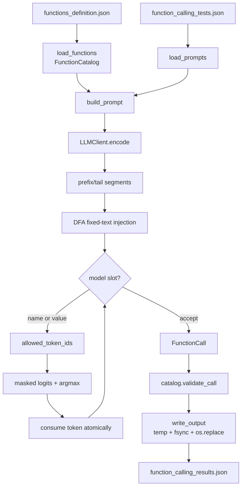

# Architecture and design decisions

This document is the defense-oriented companion to the README. It answers three
questions quickly:

1. **Where is each responsibility?** — the module map and the data flow.
2. **Why is it built this way?** — the decisions and their trade-offs.
3. **What breaks if I change it?** — the live-modification map and limitations.

The README is the public overview; this file is the map for reading, reviewing
and modifying the code under pressure.

---

## Repository map

```text
.
├── src/                    application code (no torch/transformers imports)
│   ├── __main__.py         argparse CLI, exit codes, error policy
│   ├── pipeline.py         batch orchestration, decoder index, atomic writer
│   ├── schemas.py          Pydantic catalog/output models and call validation
│   ├── data_loader.py      JSON input loading with typed errors
│   ├── prompt.py           compact prompt, template and fixed/slot segments
│   ├── vocab.py            tokenizer.json parsing, token_text, indexes, cache
│   ├── dfa.py              30-state DFA for the exact output template
│   ├── decoder.py          mask, logits, argmax, EOS policy, generation loop
│   ├── llm_client.py       thin wrapper over the public llm_sdk
│   ├── config.py           token/time budgets and measured constants
│   └── errors.py           ProjectError hierarchy
├── experiments/            baseline, prompt size, profile, time, accuracy, metrics
├── tests/                  fast unit tests + marked slow model tests
├── data/input/             functions_definition.json, function_calling_tests.json
├── docs/                   this map
└── llm_sdk/                provided by the school; never modified
```

`src/` never imports `torch`, `transformers`, `outlines`, `vLLM` or any guided
decoding library. The only model access is through the public `llm_sdk` API,
wrapped by `src/llm_client.py`.

---

## Module responsibilities

| Module | Owns | Does **not** own |
| --- | --- | --- |
| `src/__main__.py` | Argument parsing, defaults, exit codes, one-line `error:` output | Decoding or validation logic |
| `src/pipeline.py` | One call per prompt in input order, error context, decoder-index build, atomic output | Prompt wording, DFA transitions |
| `src/schemas.py` | Catalog/output shape, strict scalar types, `extra="forbid"`, final call validation | Model choice, grammar |
| `src/data_loader.py` | Reading and validating `data/input/*.json` | Deciding what the model should call |
| `src/prompt.py` | Compact prompt, fixed template, prefix/tail segments | Masking or token selection |
| `src/vocab.py` | `tokenizer.json`, `token_text`, allowed/excluded ids, first-char index, mask cache | Deciding which token is valid |
| `src/dfa.py` | States, transitions, slot buffers, atomic character/token consumption, `NameMatcher` | Model logits or file output |
| `src/decoder.py` | Allowed-token mask, logit masking, argmax, EOS/stop policy, generation loop | Catalog schema design |
| `src/llm_client.py` | Lazy SDK load, 2-D encode normalization, 1-D logits, error translation | Prompt or decoding policy |
| `src/config.py` | `MAX_TOKENS`, deadlines, measured timing constants | Runtime state |
| `src/errors.py` | `ProjectError` hierarchy and exit-code mapping | Recovery/retry policy (there is none) |

---

## Data flow



### Per-prompt control flow

1. **Load contracts.** `data_loader` parses the catalog and prompts; Pydantic
   rejects unknown types, duplicate names, missing fields and extra keys.
2. **Build the index once.** `pipeline.build_decoder_index` parses
   `tokenizer.json`, builds/normalizes `token_text` (cached at
   `.cache/token_text.json`), excludes added/padding ids and creates the
   first-character index and the per-index mask cache.
3. **Build the prompt.** `prompt.build_prompt` lists the catalog compactly and
   states the fixed output shape. The request is appended verbatim.
4. **Inject fixed text.** `prompt.build_prefix_segments`/`build_tail_segments`
   give the decoder the exact structural tokens. `DFA.consume_token` consumes
   them atomically; the model never emits `{`, `"prompt"`, `:`, `,` or `}`.
5. **Let the model fill slots.** In the function-name slot, `NameMatcher` and
   `allowed_token_ids` allow only prefixes of declared names. In value slots,
   the DFA accepts exactly the declared type (string, number, integer, boolean).
6. **Mask before argmax.** `masked_logits` sets disallowed positions to `-inf`;
   `select_next_token` returns the highest finite allowed id. EOS is a candidate
   only when the current slot can stop (`slot_can_stop`).
7. **Commit or roll back.** `DFA.try_consume_token` works on a copy;
   `consume_token` copies the advanced state back only on full success. A token
   is never partially consumed.
8. **Validate and write.** `decode_call` parses the assembled JSON into
   `FunctionCall`; `catalog.validate_call` re-checks name, keys and types; the
   pipeline writes only after the whole batch succeeds, using a temporary file,
   `fsync` and `os.replace`.

---

## Invariants

These are the properties the rest of the project relies on:

- The output is a JSON **root list**; one object per prompt, in input order.
- Each object has exactly `prompt`, `name`, `parameters`; `prompt` is copied
  verbatim from the request.
- Parameter keys are exactly the declared keys; names are in declaration order
  in the serialized object.
- Values are strict JSON scalars: `string`, `number` (int/float, never bool),
  `integer` (int, never bool) or `boolean`.
- The model cannot emit structural text; fixed injection owns it.
- Structural validity is guaranteed by construction; semantic correctness is
  measured, not assumed.
- A failed prompt aborts the batch; no partial output file is published.
- The function decision is the model's masked argmax; no keyword, regex or
  prompt heuristic chooses the function.

The DFA validates the **structure**, not the **key order** in the abstract. That
is intentional: the decoder injects keys in a fixed order, so a reordered object
can never be produced by the model. `test_matrix_wrong_key_order_is_rejected` is
a strict `xfail` that records this assumption; if injection changes, the test
fails immediately.

---

## Decisions and trade-offs

| Decision | Why | Cost / trade-off |
| --- | --- | --- |
| **Template-specific DFA** (30 states) instead of a general JSON grammar | Much smaller transition table and mask scan; the output shape is fixed | The DFA is tied to the template; changing the template touches several modules |
| **Fixed-text injection** instead of asking the model for the whole JSON | Saves model steps, removes syntax errors and key-order noise; the 0.6B model only fills slots | The decoder, prompt and DFA must agree on the exact template |
| **Token-level atomic consumption** (`try_consume_token` copy, `consume_token` commit) | A rejected token cannot corrupt the state or buffers; safe rollback | One copy per candidate token; acceptable at this vocabulary/step count |
| **Greedy argmax** instead of sampling | Deterministic, reproducible, cheapest per step; the task needs one correct call, not diversity | No exploration; a locally wrong token cannot be recovered |
| **Slot-scoped mask** (`_SLOT_TARGETS`) | Only the active slot can advance; injected states return no model candidates | Slot mapping must be updated with new states/types |
| **Mask cache keyed by `(state, discriminator)`** | Keeps the mask transparent while reusing it across prompts; ~52% faster masking in T8.3 | Cache key must include every buffer that changes the allowed set |
| **Compact prompt + `Return one JSON object` stop cue** | 133–151 prompt tokens instead of 383–402; meets the 5-minute budget; the cue is what makes the 0.6B model stop | Prompt variants without the cue hit `MAX_TOKENS`; wording is load-bearing |
| **`NUMBER_EOS_BONUS = 25.0`** in the number slot | Calibrated EOS bias stops a complete number instead of rambling into `.`/digits | It can stop `2.0` as `2` (still a valid number); precision can be lost |
| **Pydantic at both boundaries** | Strict types, `extra="forbid"`, clear messages; catches any decoder/parser gap | Pydantic is another dependency and a second source of validation rules |
| **No heuristics, no retries/fallback** | The subject requires the model to decide; a retry loop would hide failures and distort the measurement | A wrong call is reported, not repaired; the batch aborts on a project error |
| **Lazy SDK load** | Importing the CLI is cheap; tests inject a fake backend | The first real call pays the model load cost |
| **Atomic writer** | Readers never see a partial file; validation happens before any filesystem change | Extra temp file and fsync per run |
| **One model, CPU, no KV cache/batching** | Mandatory scope and a 5-minute budget; the public SDK exposes no KV cache | Performance depends on prompt length; no throughput optimization |

---

## Live-modification map

The evaluator may ask for a small change. Locate it here first.

| Change | Files to touch | What to verify |
| --- | --- | --- |
| Add/remove a function or parameter | `data/input/functions_definition.json` only | `test_real_catalog_validates`, `test_schemas.py`, prompt/DFA are data-driven |
| Change prompt wording | `src/prompt.py` (`build_prompt`) | `experiments/accuracy.py --score-only` and `experiments/time_budget.py`; keep the stop cue |
| Change `MAX_TOKENS` or deadlines | `src/config.py`, `src/decoder.py` defaults | Time budget, `MAX_TOKENS` error tests, full fixture runtime |
| Add a new scalar type | `src/schemas.py` (`KNOWN_PARAMETER_TYPES`), `src/dfa.py` (states/transitions/slot validation), `src/decoder.py` (`_SLOT_TARGETS`), `src/prompt.py` (signature) | DFA matrix, validation matrix, edge cases, mask tests |
| Change the output template | `src/prompt.py` (`TEMPLATE_KEYS`, `build_template`, segments), `src/dfa.py` (state table/transition), `src/decoder.py` (slot map) | DFA full-path/matrix tests, template tests, pipeline tests |
| Change the stop policy | `src/decoder.py` (`slot_can_stop`, `NUMBER_EOS_BONUS`), `src/config.py` | Number/boolean/string stop tests, real integration |
| Change catalog/type validation | `src/schemas.py` (`validate_call`, `validate_against`) | `test_validation.py`, `test_function_call.py`, pipeline error tests |
| Replace the model/backend | `src/llm_client.py` only (public SDK surface) | No `torch`/`transformers` imports in `src/`; fake tests; one slow real test |
| Tune performance | `src/prompt.py`, `src/config.py`, `src/decoder.py`; measure with `experiments/time_budget.py` | Stay under 300 s; accuracy unchanged |
| Change error/exit behavior | `src/errors.py`, `src/__main__.py` | Error matrix, no traceback, exit 1 |

---

## Known limitations

- **Argument accuracy is 10/16 (62.5%)** on the defined prompts. Failures are
  concentrated in long string slots and the regex/replacement split; the model
  copies closing braces or prose. Closing this needs a larger model or span
  extraction in the decoder, both outside the mandatory scope. No heuristic
  cleanup is applied.
- **No "no function" option.** The grammar forces one declared function per
  prompt; an unrelated prompt still produces a schema-valid call. This is the
  subject contract (one call per prompt), not an error path.
- **Flat arguments only.** `object`/`array`/nested parameters are rejected at
  catalog validation; there is no grammar for them.
- **Fixed template.** Key order is fixed; trailing commas and outer whitespace
  are not accepted. The model never emits these, but a hand-written output that
  reorders keys would not be produced by the pipeline.
- **Number precision edge.** The EOS bonus can stop `2.0` as `2`. The catalog
  accepts an int for a `number`, so schema validity holds, but a float value may
  lose its fractional part.
- **No KV cache, batching or streaming.** Each step re-reads the whole context;
  the 300 s target is met by shrinking the prompt, not by a faster forward pass.
- **One model, CPU only.** `Qwen/Qwen3-0.6B`; no GPU path and no model switch.
- **Lossy SDK decode.** `token_text` is built through the public decode; added
  tokens are preserved from the tokenizer metadata, and byte-level ids that
  decode to the replacement character are handled explicitly.
- **A bad prompt aborts the batch.** This is deliberate: no partial output is
  written, but one failure prevents the remaining prompts from running.
- **The mask cache is process-local.** It is not persisted; a fresh process
  rebuilds it (the token-text cache is persisted).

---

## Testing map

| Layer | Files | Command |
| --- | --- | --- |
| DFA, validation, mask, argmax, EOS | `tests/test_dfa.py`, `tests/test_validation.py`, `tests/test_decoder.py` | `uv run pytest -q -m "not slow"` |
| Pipeline, CLI, errors, loaders, prompt | `tests/test_pipeline.py`, `tests/test_cli.py`, `tests/test_errors.py`, `tests/test_data_loader.py`, `tests/test_prompt.py` | same |
| Edge cases and ambiguous prompts | `tests/test_edge_cases.py` | same (fake); one `slow` real case |
| Accuracy and metrics | `tests/test_accuracy.py`, `tests/test_metrics.py` | same |
| Real model end-to-end | `tests/test_integration.py` | `uv run pytest -q -m slow tests/test_integration.py` |
| Real model/tokenizer/vocab | `tests/test_vocab.py` (marked `slow`) | `make test-all` |

The fast suite (580 tests) takes about 5.5 s and never imports torch or loads the
model. The slow tests are explicitly marked and excluded by
`pytest -m "not slow"`.

---

## Reading order for the defense

1. `README.md` — problem, result, commands and public design summary.
2. `docs/ARCHITECTURE.md` (this file) — map, flow, decisions, limitations.
3. `src/decoder.py:decode_call` — the generation loop and the EOS policy.
4. `src/dfa.py:DFA.consume` / `transition` — the grammar and atomicity.
5. `src/prompt.py:build_template` / `build_prompt` — what is injected vs. generated.
6. `tests/test_dfa.py`, `tests/test_decoder.py`, `tests/test_edge_cases.py` — the cases that justify the design.
7. `experiments/accuracy.md`, `experiments/report.md`, `experiments/benchmark.md` — the measured numbers.
8. `docs/DEFENSE.md` — the 10-minute script, likely questions and live drills.
